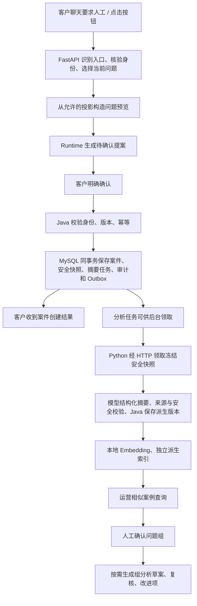

# 人工交接问题分析：第一阶段需求与实现设计

日期：2026-10-11；修订：2026-10-12。状态：本版实施合同，验收结果以独立实现证据为准。

用途：供实现与验收。依据用户采纳的重写说明，将确认后异步单条模型摘要纳入本版。本文描述要求，不代替运行报告。

## 1. 先用一句话说清楚产品

客户要求人工时，系统保留一份经过脱敏、区分客户陈述与已核验事实的问题记录；运营人员可以找出表达不同但问题相近的案例，人工确认它们是否属于同一问题，再形成有证据的改进建议。

第一阶段不是自动给所有聊天打标签，也不是自动判定业务责任。它要先解决三个问题：有内容可以分析、相似案例可以找出来、运营可以确认并追踪问题。

例如，以下是合成教学样例，不是真实客户数据：

- 案例甲：“想申请换货，但不知道需要准备哪些材料。”
- 案例乙：“换货入口让我提交凭证，但不知道凭证要求。”
- 案例丙：“想退款，但没有找到申请入口。”

甲、乙可能共同指向“换货材料要求不清楚”；丙不能仅因也有“申请”二字就并入。Embedding 提供候选，运营确认问题组。模型随后只能提出“可能需要完善材料说明”等建议，不能声称已经证明页面设计是根因。

## 2. 当前代码事实与本阶段新增内容

以下事实来自只读源码检查；没有连接当前运行实例，因此不确认实际启用的配置、运行性能或生产效果。

| 已核对的实现 | 对本阶段的意义 |
| --- | --- |
| `mall-ai-service/app/services/conversation_entry.py` 的结构化路由包含 `handoff`，提示词区分明确要求人工与询问人工服务信息 | 不需要重新建一个关键词转人工系统；应在统一入口上补测试和边界 |
| 明确要求人工后，Runtime 准备提案，客户确认后才正式提交 | 保留确认、身份、版本、内容哈希与 Java 幂等边界 |
| `human_handoff.py` 已有业务主题、客户原因、来源、渠道等枚举 | 可以作为筛选条件，不能假装已有自然语言问题发现 |
| `task_runtime.py` 的交接准备接收主题、原因，记录计划版本、完成步数和核验事实数 | 枚举与计数不等于“客户具体卡在哪里”；需要新增安全问题投影 |
| Java 已有交接记录、上下文计数、请求幂等、审计、Outbox 和运营管理链路 | 扩展已有案件，不再另建一套业务案件权威 |
| `handoff_analysis_worker.py` 输入主要是枚举、阶段、计数，且不能随意覆盖客户选择的原因 | 现有 worker 没有读脱敏聊天并发现未知主题的功能 |
| `embedding_service.py` 已有本地 FastEmbed/BGE 路径；仓库已有 Chroma 依赖 | 可评估复用加载机制；独立建立案例索引，不能直接混入政策 RAG |
| 已有运营筛选、人工复核、改进项和保留策略 | 复用管理流程；新增语义分组权限与证据，而非重新包装相同枚举 |

旧的诊断交接、旧的运营分析接口与新的显式人工交接并不完全相同。实现时以 `docs/HANDOFF_UPGRADE_IMPLEMENTATION.md`、统一聊天入口和现行确认链路为准；保留旧接口兼容，不把旧自动登记行为重新引入。

## 3. 第一阶段范围与边界

必须完成：

1. 保留客户主动要求人工、按钮入口、系统建议后客户接受三种来源。
2. 在交接预览中形成冻结安全输入，客户确认后由 Java 同事务保存案件、快照和摘要任务。
3. 异步模型生成具体问题摘要，校验后为内容足够的摘要生成本地向量，支持受权限约束的相似案例查询。
4. 运营创建问题组、加入/移出案例，保留人工依据和审计。
5. 显示真实统计及覆盖率；支持按需生成可追溯的组分析草案。
6. 具备版本控制、重试、删除传播、权限隔离和可执行验收。

本阶段不做：自动聚类并自动合组、全量历史聊天采集、自动根因结论、自动修改政策/代码、自动执行退款、跨角色查看客户隐私、训练新 Embedding 模型、自动升级旧枚举记录为丰富问题记录。

运营是查看问题规律与推动改进的角色；人工售后处理人员负责接案、核实与处理客户业务。运营分组不能修改案件处理结论或获得售后写权限。

## 4. 总体架构：两个流程，不让客户等分析

调用边界：Vue 到 FastAPI、Python 到 Java 都是 HTTP；Python 服务内部的清洗、模板构造、向量运算是函数调用；Java 经 MyBatis/数据库连接保存 MySQL。Python 不直接连接商城业务数据库。Python 到本地 Embedding 是本进程调用，本阶段不增加云 Embedding。

Java 保存权威记录、分组、审计与分析任务。Python/Chroma 保存可重建的向量索引，不是业务权威。Chroma 只是索引存储选择，不能代替权限校验或保证返回记录尚未删除。

## 5. 如何触发人工交接

### 5.1 明确请求与按钮

- 点击按钮：直接调用已有准备交接入口，不需要让模型再判断是否点击了按钮。
- “我要人工客服”“请把这个问题交给人工”：统一路由输出 `handoff`；只能准备提案。
- “退货需要人工审核吗”“人工客服几点上班”：是信息询问，不应创建交接提案。
- “算了，找个人吧”：结合当前上下文判断；歧义无法解除时询问是否转人工。
- 多个活动任务：让客户选择要交接哪个问题；不能偷偷选择最近一个订单。
- 没有关联任务：允许一般咨询交接，不能因为没有订单事实而禁止客户寻求人工。

意图识别沿用当前结构化模型路由，服务端验证路由枚举和任务归属。可以增加高精度按钮/明确命令短路，但不能用“含人工二字”代替动作判断，也不宣称路由已具备校准后的置信度。

### 5.2 系统建议

事实不足、工具依赖失败、权限或能力限制等可以产生建议；客户接受后进入同一准备与确认流程。建议本身不是客户主动请求，不自动创建案件。保存 `source=system_suggested_accepted`，与 `customer_requested` 分开统计。

### 5.3 不改变原有写入安全规则

仍需登录、身份和任务归属检查、有效确认、版本与哈希一致、Java 再校验。超时后不能生成新幂等键盲目创建第二个案件。沿现有请求标识查询/对账；只有已验证的幂等协议允许，才按原标识有限重试。

## 6. 给运营保存什么，不保存什么

### 6.1 核心数据合同

下表字段为拟新增/扩展合同，名称允许与现有命名统一，但语义不能被省略。

| 字段 | 含义与来源 | 约束 |
| --- | --- | --- |
| `case_ref` | Java 生成的 opaque 案件引用 | 不暴露数据库内部 ID 或订单号 |
| `projection_version` | 安全问题投影的版本 | Java 分配；每次有效修订递增 |
| `business_topic` | 退款、退货、换货、物流、政策等已有主题 | 客户选择/任务受控主题；未知允许保留 |
| `customer_reason` | 客户选的转人工原因 | 保留原始选择，不能当成已证实根因 |
| `trigger_source` / `entry_channel` | 谁提出、聊天还是按钮 | 从服务端链路取值，不信任前端角色声明 |
| `customer_goal` | 客户希望完成什么 | 安全短句，建议上限 120 字 |
| `unresolved_question` | 当前尚未解决的具体问题 | 安全短句，建议上限 240 字；不足时为空 |
| `customer_statement` | 客户自述的必要背景 | 最多 240 字，明确“未核验”；不是聊天原文副本 |
| `verified_fact_codes` | Java 已核验的必要事实类别 | 受控枚举，例如资格未确认；不保存订单载荷 |
| `evidence_refs` | 允许的事实/执行证据引用及版本 | opaque reference，建议最多 10 个，按角色过滤 |
| `stage` / `outcome_code` | 系统停在哪、实际完成到哪 | 服务端状态投影，不能由模型编造 |
| `content_quality` | READY / INSUFFICIENT_CONTEXT / REDACTION_REJECTED | 说明能否用于语义检索 |
| `projection_hash` | 上述规范化内容的哈希 | 用于幂等、索引失效与溯源 |
| `redaction_version` / `summary_template_version` | 清洗与问题表达规则版本 | 支持复现和重建 |
| `created_at` / `expires_at` / `deleted_at` | 生命周期信息 | Java 权威；索引同步相同删除约束 |

主题、转人工原因、重复问题组是三件事。一个“换货”主题下可以有“材料要求不清楚”“资格判断冲突”“入口不可用”等不同组。Embedding 不覆盖客户原因，更不从相似分数推出责任原因。

不保存：完整原始对话、完整 Prompt、模型思维链、地址、手机号、姓名、订单号、Token、原始工具载荷、RAG 原文。运营不需要靠这些信息判断共性。人工处理所需的业务详情仍走其专用身份与 Java 接口，不能从运营 DTO 取得。

### 6.2 这些短句怎么产生

采用确认后异步摘要，不在后台拉取整段聊天：

1. 从当前任务允许公开的目标、任务阶段、有效 Artifact 投影和客户本次明确选择取值。字段先经过 allow-list，禁止把任意 Artifact 的 `summary` 当成已经安全。
2. 原仓库没有可直接复用的丰富安全会话片段。新增轮次进入时独立生成经过业务词汇完整匹配的安全片段，保留角色、否定和具体条件；未知词句排除并标记缺失，不回读原始历史。
3. 上下文不足时，在交接预览中让客户可选填写/确认一个简短问题描述；不填也能交接，只是标记内容不足。
4. 对这段新描述做长度限制、字段过滤、个人信息检测与脱敏、危险内容排除，形成安全预览。检测不确定时不持久化该自由文本，回退为结构化投影。正则不能被宣称为完整脱敏保障。
5. 向客户展示安全输入，确认后固定版本与哈希，提交 Java；Java 提交案件后，worker 异步生成摘要。客户确认输入与交接动作，不是确认尚未生成的 AI 总结。

客户原输入只沿既有请求处理临时使用，不新增聊天日志/历史复制。禁止在异常日志、Trace、测试证据中记录原输入。不得先送新的外部摘要模型，再做脱敏。

**第一阶段必须新增单条摘要模型调用。** 摘要包含 customer_goal、handling_steps、unresolved_question、customer_statements、handoff_reason_statement、uncertainty_notes、evidence_refs；缺失用 null/空列表。每条陈述带来源引用，助手解释不能升级为业务事实。模型只读取冻结安全快照，不使用粗分类模板冒充具体摘要。最多八片段、三千字符；当前实现使用保守 UTF-8 字节上界，不声称准确 tokenizer 计数。模型前过滤，模型后校验 Schema、敏感信息、来源和受控矛盾。

### 6.3 一个转换例子

以下全为合成数据：

| 转换阶段 | 内容 |
| --- | --- |
| 请求期间的客户表达 | “这款耳机换货要哪些凭证？还是没弄懂，帮我转人工。”仅用于当前入口处理，不新增持久化副本 |
| 允许的任务投影 | 主题 exchange；目标“了解换货材料”；阶段 policy_explanation；已核验事实数 0 |
| 安全问题记录 | goal“了解换货所需材料”；unresolved“未理解凭证要求”；statement 空；事实空；来源 customer_requested |
| 向量输入 | “主题：换货。目标：了解换货所需材料。未解决问题：未理解凭证要求。” |
| 运营页面 | 上述安全问题、来源、时间、内容质量、相似候选；不能查看客户原话或订单信息 |

“没理解凭证要求”只有在客户本次安全确认或允许的投影包含该信息时才写入。只有“转人工”四个字时，不能自行补出前面的短句，应标记 `INSUFFICIENT_CONTEXT`。

完整案件对象保存在 Java；运营收到的是允许投影；向量是投影的派生表示；证据引用只是访问受控证据的指针。这四者不能互相替代。

## 7. 保存、异步索引与恢复

### 7.1 保存时序

客户确认后，Java 在同一数据库事务中保存/关联案件、冻结安全快照、单条摘要任务、审计与相应 Outbox。选择同事务创建摘要任务，事件不另建任务。摘要通过后 Java 更新派生问题版本并登记索引待处理状态。

建议复用现有 Java 内部领取协议：由 Python worker 经 HTTP 领取索引工作；Java 保存租约、次数、状态和输入版本。索引失败不回滚已经创建的人工案件，也不能让客户重新确认案件。

### 7.2 新增数据实体

建议使用独立表，具体 DDL 由实现 Agent 在阅读现有迁移后确定。所有迁移只新增到 `mall2/document/sql/migrations/VyyyyMMdd__description.sql`。

| 拟新增实体 | 保存内容 | 权威位置 |
| --- | --- | --- |
| 问题投影 | 第 6 节字段、案件引用、版本与生命周期 | Java / MySQL |
| 单条摘要任务 | 冻结安全输入/hash/版本、租约、次数、模型版本、结构化摘要、复核状态与安全错误码 | Java / MySQL |
| 摘要审计 | 输入 hash、摘要版本、模型/人工来源和操作者 | Java / MySQL |
| 索引任务 | 输入版本/hash、状态、租约、重试次数、模型/模板版本、安全错误码 | Java / MySQL |
| 问题组 | 标题、说明、主题、taxonomy/version、创建者、状态、修订版本 | Java / MySQL |
| 问题组成员 | 案件引用、投影版本、加入依据、人工接受/拒绝、审计 | Java / MySQL |
| 组分析任务与产物 | 快照hash、可信统计、样例引用、模型版本、结构化草案、复核状态 | Java / MySQL |
| 案例向量 | 投影ref/hash、模型版本、模板版本、向量 | 独立持久化 Chroma 索引；可重建 |

每个当前 taxonomy 内，一个案件最多属于一个有效主问题组；允许独立的多标签，但不能借多标签重复计数。成员变更用数据库唯一约束和乐观版本控制，不能只依赖前端禁用按钮。

### 7.3 索引任务状态与重试

摘要单独使用 PENDING/RUNNING/SUCCEEDED/INSUFFICIENT_CONTEXT/FAILED/DELETED。并发一、超时三十秒、输出一千 tokens、租约九十秒、每输入版本最多两次模型尝试。失败不撤销案件，人工重试不重置次数。旧租约/版本不能覆盖新结果。人工纠正形成新摘要版本与审计，旧向量立即失效，引用旧内容的组分析需更新。

状态：PENDING → RUNNING → READY，失败按 RETRYABLE/FAILED/INSUFFICIENT_CONTEXT 区分；删除后 DELETED。Java 租约到期不需要自动改状态，下一次领取查询必须显式包含可回收的过期 RUNNING 任务，并以条件更新成功为准。

建议初始配置：worker 并发 1、批量 16、每个任务最多 3 次尝试、60 秒租约、单次本地编码目标上限 20 秒；均为拟定保护参数，不是实测 SLA。超过时限的底层计算应通过可终止执行单元/隔离 worker 处理，不能仅取消 await 就声称计算已停止。长批次应续租或缩小批量。

派生写入幂等标识至少包含 `projection_ref + projection_hash + embedding_version + template_version`。只有相同租约和相同输入版本仍有效，Java 才接受 READY 结果。

进程在写入索引后、回报 Java 前崩溃：可以再次 upsert 同一派生记录，但不能重建案件或重放 Java 业务动作。旧版本 worker 晚返回：拒绝结果，异步清理旧向量。Chroma 丢失：从仍有效的 Java 问题投影重建，重建期间明确显示缺失覆盖率。

## 8. Embedding 到底怎么用

### 8.1 它与 K-means、KNN 不是三选一

- Embedding：把短问题表达成向量，是表示方式。
- 相似检索：用向量距离找邻居，是第一阶段的用途。
- K-means/HDBSCAN 等：把一批向量分组，是第二阶段候选算法。
- KNN 分类：有人工标签后，用邻居标签预测新记录类别；单纯最近邻检索不要求标签。

先做相似检索是因为现有记录内容不足、问题组尚未稳定，直接自动聚类很容易产出“看着像但无业务意义”的组。人工反馈能为后续比较算法提供数据。

### 8.2 模型和输入

候选为仓库已有本地 `BAAI/bge-small-zh-v1.5` 路径，现有默认维度为 512。实现需核对实际 FastEmbed 模型映射、文件版本、输出维度和预处理，而非把配置存在当成运行验证。

为案例相似度使用对称输入：查询与候选都采用同一问题模板。不得一边加搜索指令、一边不加，并把结果当作对称案例距离。模型卡针对检索的指令建议不等于本任务必然适用，需记录实际转换并比较样本。

模板只包含主题、目标、未解决问题；不把案件 ID、时间、客户身份、计数、长错误堆栈拼入语义文本。客户原因保留筛选字段，不强制拼入，避免所有“想找人工”互相相似。空模板、通用句“请求人工”不生成向量。

### 8.3 计算与排序

编码后检查向量维度、有限值和非零范数，然后 L2 归一化。两个归一化向量的点积就是余弦相似度。分数反映模型空间相近程度，不是“同一问题概率”。

初始按权限/数据范围、时间窗口、主题筛选 Java 候选，再只读取这些候选的有效同版本向量，进行精确余弦排序。默认 Top-K=5，最大 20；排除查询案例本身，同分按稳定 ref 排序。

初始精确比较上限建议为每次 5000 个有效候选；超限返回“请缩小范围”或发起明确的异步完整任务。不能静默截断前 5000 条并声称是全部数据中的最近邻。不同模型、模板版本不能混算。

第一阶段不需要 ANN。精确计算便于建立正确基线；数据规模或延迟确有问题时再引入近似索引。Chroma 可用于按 ref 读取向量，但不能拿其默认 Top-K 搜索替代上述先筛选后精确排序的合同。

### 8.4 筛选范围

默认同主题、最近 30 天，可切换 7 天。未知主题可以在当前授权范围内独立搜索，并提示分类缺失；不能把 unknown 强行改成退款。跨主题搜索由运营显式开启并显示标识。软删除、过期、不允许角色访问、无有效向量、版本不匹配的记录不得参与。

排序返回前再经 Java 批量校验允许公开的引用/版本，防止缓存中过期记录泄露。返回相似分数不代表候选已经被认定为重复问题。

### 8.5 阈值怎么定

禁止直接写死“0.8 以上都是重复”。BGE 模型卡明确提醒分数分布需要按具体数据校准。

实现先建立合成、脱敏的成对样本：同问题不同表达、同主题不同问题、相同词不同目标、客户要求人工但没有内容、否定表达和多问题混合。由人工标注“同一可改进问题 / 相关但不同 / 无关”。

按底层问题及改写家族划分开发集与保留集，避免同一句改写同时出现在两边。比较原始句与问题模板；保留集上报告每个阈值的候选准确率、召回、覆盖量和样本数。初始建议以候选准确率 90% 为目标，达不到就展示排序候选，不启用“高相似”徽标；目标不是已获得结果，也不是所有领域的通用标准。

界面始终叫“相似候选”，没有“自动确认同问题”。人工拒绝也要留下安全反馈，供后续评估。

## 9. 运营实际怎么使用

### 9.1 页面与交互

1. 列表按 7/30 天、主题、来源、客户原因、内容质量、索引状态筛选。
2. 点一个案例，分别查看摘要与索引状态、具体目标、处理过程、未解决问题、客户陈述与不确定项。摘要生成后标注 AI 未复核；待生成/失败/不足不显示模板冒充结果。支持有来源的人工纠正与有界重试，不显示原始聊天。
3. 点“找相似案例”，列出候选短摘要、分数、来源、阶段、时间和已有问题组。
4. 运营判断“同一个可改进问题 / 相关但不同 / 无关”，可以加入既有组或创建新组。
5. 问题组页显示独立案件数、来源分布、客户原因分布、内容覆盖率、组成员和人工修订历史。
6. 可生成分析草案，审核后关联已有改进项流程。

相似性不具备可靠的传递性：甲像乙、乙像丙，不代表甲和丙属于同组。本阶段禁止把近邻连通分量自动当成问题组。

### 9.2 统计怎么解释

计数由 Java 查询确定，LLM 不负责计数。默认以案件创建时间的窗口为准，保存 UTC，界面注明展示时区；不能一处按创建、一处按分析完成统计。

至少展示：窗口内可访问案件数、内容足够数、有效索引数、已人工归组数、待归组数。来源分开统计；同一个案件的重试、事件与多次向量重建不重复计入。

没有完整且定义一致的咨询总量，就不能报告“全站转人工率”。问题组占比只能写“本窗口记录到的人工案件中占比”。选了 5 个样例不能说模型阅读了所有案件。

## 10. 大模型用在哪里、输入输出是什么

本阶段入口意图识别继续用模型；新增单条摘要默认在确认后异步执行，另有运营按需生成组分析草案。两种生成任务分开记录来源与用量；本地 Embedding 不是生成式模型。组分析默认关闭，授权启用。单条摘要失败保留案件与基础统计；组分析失败保留人工组。

前置条件：组至少包含 2 个经过人工确认、内容足够的案例；Java 冻结组版本、可信统计和样例引用；Python 最多取 5 个具有差异的有效样例，不复制整组聊天。选样策略版本化，不能只挑最能支持某个结论的记录。

输入：组标题、窗口、Java 统计、已确认成员的安全问题投影、证据引用、明确的数据缺口。所有用户短句视为数据而非指令，模型无工具/业务写权限。

严格 Schema 输出：

- `shared_issue`：这些样例共同未解决的问题。
- `evidence_refs`：支持描述的样例引用，只能引用输入白名单。
- `hypotheses`：可能原因，每条附依据和不确定性；不足可为空。
- `suggested_actions`：建议检查页面、政策说明、检索或接口等，每条附人工验证办法。
- `limitations`：未核验事实、样本覆盖限制、不可推断的内容。

服务端校验引用存在、字段长度、敏感信息、不得新增事实；模型结构失败最多再尝试 1 次，不无限纠正。建议单次超时 30 秒、输出上限 1200 tokens、并发 1；由实现方核对服务端参数确实生效，费用按真实模型用量记录。不在本文新增或承诺付费调用。

结果是“待复核草案”；不能自动修改组标签、归并案件或生成售后写动作。运营采纳后创建改进项，保存产物版本和采纳依据。模型不可用时，人工仍能看统计、找相似案例、归组和登记改进项。

## 11. 建议接口与职责

以下是语义合同，均为拟新增接口，不是声称仓库已有对应路径。可沿现行前缀命名；实现文档必须列出最终路由。

| 调用 | 动作 | 安全约束 |
| --- | --- | --- |
| 客户 Vue → FastAPI | 准备交接、查看安全预览、确认 | 沿现有提案；不开放绕过确认的 Java 写入口 |
| FastAPI → Java Portal | 确认创建并保存冻结的问题投影 | 客户身份、owner、版本、hash、幂等、事务、审计 |
| Python worker → Java Admin 内部 API | summary/lease、summary/result；获取冻结安全输入与提交摘要 | 服务身份、租约、input version/hash；输出不能改变业务事实 |
| 运营 Vue → FastAPI → Java Admin | cases/{ref}/summary、纠正与 retry | 运营权限、摘要版本、来源与审计；重试不重建案件 |
| Python worker → Java Admin 内部 API | 领取索引任务、读取允许投影、提交结果 | 窄服务身份、租约token、版本、hash；不借运营Token |
| 运营 Vue → FastAPI → Java Admin | 获取有权限的候选引用与投影 | Java 核验运营身份/范围，前端不能扩大范围 |
| FastAPI → 本地向量索引 | 取指定有效引用向量并精确排序 | 不直接访问 MySQL；查询后 Java 再校验 |
| 运营 Vue → FastAPI → Java Admin | 创建组、成员增删、人工判定 | 新增窄的运营分组权限、幂等、乐观版本、审计 |
| 运营 Vue → FastAPI → Java Admin | 创建/读取组分析任务、复核、关联改进项 | 冻结快照；结果无业务执行权限 |

相似查询响应：query_ref、query_projection_version、model/template_version、window、eligible_count、indexed_count、candidate_refs、scores、safe_projection、warnings。内部 lease token、主键、Prompt 和原始向量不在公开响应中。

写接口使用唯一请求标识和 `expected_version`；版本冲突返回可识别的冲突错误，不能静默覆盖另一个运营人员的分组。未登录、无权限、内容不足、索引待生成、范围超限、模型不可用分别给出稳定错误码和可理解提示。

## 12. 保留、删除与索引清理

沿当前保留策略扩展，不悄悄延长安全文本的保存期：闭案背景当前设计默认 90 天，事件 365 天；正式实施先核对现行代码和配置。新问题投影及向量建议跟背景生命周期一致，活跃/重开/hold 按原规则处理。

Java 删除/过期事务清理安全快照与摘要，记录 tombstone 与清理任务；Python 按引用删除向量，失败可重试。查询即时经 Java 排除已失效记录，不等待清理完成。派生索引不保存摘要副本。摘要晚到结果不能复活删除记录。

组分析草案包含问题文本，也必须跟踪来源生命周期：来源删除后标记草案不可用并清理含该内容的产物；只在审查允许时保留无文本的操作审计。不能“删案例但在模型总结里永久留着”。模型供应商保留政策另行核实，不能承诺清理本地就清除了供应商数据。

## 13. 新增可见性与成本决策记录

| 变化 | 用户可见性 | 验收路径 | 非目标与失败回退 |
| --- | --- | --- | --- |
| 问题投影 | 客户确认预览；运营只看安全描述 | 合成敏感输入→预览→Java→运营 DTO | 不采集完整聊天；不安全则拒绝文本、保留普通交接 |
| 单条模型摘要 | 客户不等待；运营看到 AI 未复核的具体问题 | 冻结快照→真实模型→来源/忠实性检查→Java→索引 | 不回读原聊天；内容不足或失败仍可处理案件 |
| 本地向量 | 运营看到候选与分数，不看到向量 | 固定合成样本与精确排序 | 不承诺模型效果；索引不可用仍可人工筛选 |
| 运营分组权限 | 运营可改问题组，不能处理客户业务 | 跨角色拒绝测试与审计 | 不复用售后角色权限或 Token |
| 新组分析调用 | 运营可请求待复核草案 | 冻结样例、Schema、引用与用量证据 | 默认关闭；超时/失败保留组与统计 |

耗时目标按本地实测后确定，当前仅设保护上限。客户请求不等待 Embedding 或组分析；慢任务显示 PENDING/RUNNING，可取消分析但不能取消已创建案件。

## 14. 实现顺序与交付清单

### A. 对齐合同与权限

阅读现有交接、运营、迁移、测试及 Compose；保留无关修改。确认安全字段来源、角色允许范围、冻结版本、保留期、接口响应和索引失效机制。先补本设计的具体合同再写实现，不能把自由文本字段直接放开。

### B. Java 权威记录与客户预览

新增安全片段生产、冻结快照、摘要任务与索引任务迁移；保持交接事务边界。接入提案预览，确认后保存并异步摘要。先证明普通交接不被分析依赖阻塞，再验收具体目标、处理过程、否定与未解决追问的忠实性。

### C. 本地索引与精确检索

单独版本化案例索引、领取与重试、归一化验证、范围筛选、精确排序、Java 返回前再核验、覆盖统计和删除传播。先无模型生成草案地完成相似查询。

### D. 人工问题组与反馈

问题组与成员权限、乐观版本、人工同/异问题反馈、统计与 UI、已有改进项关联。成员变更不修改案件业务状态。

### E. 可选组分析

按需、异步、默认关闭；严格 Schema、引用核验、快照失效、安全日志与费用记录。组分析不可用仍可使用有效摘要、相似检索与人工归组；单条摘要不可用时仅保留基础记录，不声称具体摘要能力可用。

### F. 交付证据

提交最终接口合同、字段 allow-list、迁移与回滚说明、配置清单、合成样本、确定性测试报告、独立现场证据与局限；没有授权的 live 路径必须写未执行，不能用 Mock 结果冒充。

## 15. 验收标准

### 功能和安全

- 明确要求人工能准备交接；“需要人工审核吗”不误建；按钮不依赖模型判断；多任务不乱选；无任务也允许一般咨询。
- 没有确认不建案；确认重试、超时对账不重复建案；任务恢复不会重新执行已成功 Java 动作。
- 客户描述中的合成隐私字段不能出现在运营 DTO、索引元数据、日志、Trace 或证据文件。
- 仅“转人工”且无可用上下文：正常建案，标记内容不足，不能进入伪造的相似结果。
- 运营/人工处理人员/质量开发者权限隔离，跨范围候选不可查询；分组不能修改售后处理状态。
- 删除后即使旧向量仍在，API 不返回该内容；worker 过期结果不得复活删除数据。

### 算法和统计

- 固定向量验证余弦排序、同分稳定性、异常向量、Top-K、范围超限与模型版本隔离。
- 用专用成对样本报告候选 Precision@K；只有标注了完整检索候选中的相关项，才报告该范围 Recall@K。
- 报告内容/索引覆盖率、人工接受率与拒绝原因；不能用高接受率代替完整准确率。
- 不自动合并传递近邻；重复事件不会增加案件数；未获得咨询总量时不显示整体转人工率。
- 草案中引用必须来自冻结输入，计数必须等于 Java 快照；过期组版本提示需重新分析。

### 故障

- 索引写入后 worker 崩溃、租约过期、Java 回报超时、Chroma 暂不可用、新旧版本并行、两人同时归组都具有确定结果。
- 生成模型超时、结构不合法或引用伪造：草案失败，但统计、分组和人工案件继续可用。
- 用独立合成样本报告目标准确性、未解决问题保留、处理过程忠实性、无依据新增事实、隐私泄漏及摘要覆盖率；含“没有开箱视频能否换货”、助手仅解释材料、寄回目的地难负例。无依据业务事实或敏感泄漏阻断该配置发布，不能只看 Schema 通过率。

### 实现 Agent 的验证约束

遵守根 AGENTS.md：FastAPI 完成受影响测试与全量 pytest；Java 显式 `-DskipTests=false`；Vue build；迁移/Compose 做 config 检查及经授权的本地真实路径验证；v3 发布按规定 manifest/preflight。使用唯一 caseId、fixture hash 和真实断言，不删除历史 case，不以重跑掩盖失败。

本设计阶段没有运行这些检查。将确定性合同、本地现场、live model 三种证据分开，不引用既有 39/39、478/478 等数字作为新功能成绩。

## 16. 技术依据与可借鉴方案

查阅日期：2026-10-11。以下是官方公开技术资料，不是已核实某家公司采用本方案的成功案例。

1. [Sentence Transformers：Semantic Search](https://www.sbert.net/examples/sentence_transformer/applications/semantic-search/README.html)：文本向量、余弦 Top-K；精确基线与近似检索的召回取舍。借鉴检索方法，不移植其性能数字。
2. [Sentence Transformers：Clustering](https://www.sbert.net/examples/sentence_transformer/applications/clustering/README.html)：K-means、层次聚类、局部社区发现。支持将表示、检索与聚类分开考虑。
3. [BGE small 中文模型卡](https://huggingface.co/BAAI/bge-small-zh-v1.5)：分数不是概率，阈值需要具体数据校准；检索指令与任务输入要匹配。
4. [scikit-learn：Clustering](https://scikit-learn.org/stable/modules/clustering.html)；本次实际读取其[官方文档源文件](https://raw.githubusercontent.com/scikit-learn/scikit-learn/main/doc/modules/clustering.rst)：算法假设、噪声、密度和参数差异。
5. [scikit-learn：Nearest Neighbors](https://scikit-learn.org/stable/modules/neighbors.html)；本次实际读取其[官方文档源文件](https://raw.githubusercontent.com/scikit-learn/scikit-learn/main/doc/modules/neighbors.rst)：无标签近邻检索与有标签 KNN 分类不是同一任务。

这些方法足够成熟；本项目价值在于将明确人工请求、安全问题记录、可信统计、相似发现、人工审核和改进追踪连成闭环。是否优于当前方案必须由实际评估证明，不能只因为加入 Embedding 就宣称新颖或效果显著。
