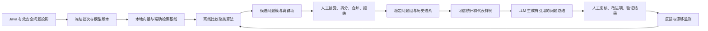

# 人工交接问题分析：第二阶段未来目标

日期：2026-10-11。状态：未来研究与工程路线，不是第一阶段必须实现的功能，不代表当前已具备或已验证。

配套文件：[第一阶段完整需求](HUMAN_HANDOFF_SEMANTIC_PHASE1_REQUIREMENTS_20261011.md)。第一阶段是安全记录、相似候选、人工归组；第二阶段在数据与证据足够后，尝试自动发现问题、稳定跟踪趋势并验证改进。

## 1. 为什么不一开始就自动聚类

Embedding 只决定向量表示。聚类算法即使产生漂亮的簇，也未必对应业务上可修复的问题。

例如“换货材料要求不清楚”与“换货审核失败”都很相似，却可能需要不同人员处理；“找不到退款入口”和“找不到换货入口”主题不同，但可能共同指向页面导航问题。需要人工反馈定义“同一可改进问题”，再评估算法。

开始第二阶段前，应具备：

- 安全摘要的内容质量与覆盖率可测，脱敏/权限/删除链路通过验收。
- 至少有一批独立问题的人工同/异标签、难负例和未知样例，而非同一句话的大量改写。
- 精确近邻基线与保留集已建立，清楚现有方案在哪些场景失效。
- 候选算法、模型版本与时间窗口可复现；人工复核资源足够。

不设没有依据的“收集满 1000 条就一定能聚类”门槛。数据的主题分布、重复密度、噪声与摘要质量比总条数更重要。

## 2. 未来架构

Java 继续保存权威数据、权限、群组、审计和任务。Python 通过 HTTP 获取允许投影，完成向量与离线分析；不能连接商城数据库。模型没有业务写权限，自动候选先进入待审核区。

## 3. 候选算法如何比较

| 方法 | 做什么 | 适用条件 | 主要限制与本项目用途 |
| --- | --- | --- | --- |
| 精确近邻＋人工归组 | 找相似例，不自动分簇 | 内容少、定义未稳定 | 第一阶段基线；不能用连通传递直接自动合组 |
| K-means | 预先选 K，分成 K 组 | 类别数量较稳定、向量结构适配 | K 难选，通常把噪声也分配到组；不保证等大小，作对照而非默认优胜者 |
| 层次聚类 | 根据距离逐步合并，用阈值截断 | 批次规模受控、希望观察层级 | 距离/链接方式敏感、成本可能高；complete/average 各有紧凑度和碎片化取舍 |
| DBSCAN / HDBSCAN | 识别密度结构，允许噪声点 | 有重复问题密集区、无需固定 K | 高维与密度差异会影响效果，HDBSCAN 也不保证语义正确；比较噪声率和稳定性 |
| 局部社区发现 | 由高相似邻域寻找重复群体 | 目标是先找明显重复问题 | 阈值、最小规模与链式扩散需控制；不是全部记录都必须归组 |
| KNN 分类 | 用人工标签预测新记录所属组 | 已有可信组与标签 | 不能发现所有新类别；需拒判、邻居一致性与版本控制 |
| ANN | 加速最近邻检索 | 精确搜索确有容量/延迟瓶颈 | 不是聚类算法；可能漏掉邻居，必须对精确基线测召回 |

初步研究顺序：层次聚类与局部社区发现作为直接对照，再按数据密度结构评估 HDBSCAN；K-means 作为明确 K 假设的基线。不因为 HDBSCAN 名字更新就认为一定最好。

余弦距离可由归一化向量构造。具体算法对 metric、稀疏矩阵与距离输入的限制应按实际库版本核对。不要先用二维 UMAP 图聚类，然后因为点聚在一起就宣称原向量语义可靠；降维结果可视化和聚类输入应分别评估。

## 4. 具体实验怎么做

### 4.1 样本与目标

以“是否属于同一个可改进问题”为主要人工标签，保留“相关但不同”“未知”。分别观察主题内发现与跨主题发现，不把两者混成一个分数。

样本包含表达改写、同词不同问题、不同词同问题、多目标、否定、系统失败、客户偏好人工、信息不足。未知/不足不是坏数据必须强行分类，而是需要保留的业务状态。

开发集用于参数选择；保留集按真实问题家族与时间分开。样本由合成或经批准脱敏数据构成，标注资料不记录原始客户对话。记录 caseId、fixture hash、标注依据和分歧。

### 4.2 对照

固定相同输入、模型与数据窗口，比较：关键词/现有主题筛选、第一阶段精确邻居、不同聚类方法。若比较不同 Embedding 模型，就单独做表示对照，不同时改变摘要模板、检索与聚类后将全部提升归功于模型。

Cross-Encoder 重排可作为候选对照，仅在误召回确实需要时加入；需要单独核对本地模型、资源、数据可见性、延迟和收益。重排不能补回从未召回的相关案例。

### 4.3 指标

- 成对准确性：人工确认同问题的 precision/recall，特别报告难负例。
- 簇纯度与人工可解释性：是否对应同一项可改进问题；不能只看 silhouette。
- 有标签时可报告 ARI/NMI 等，但注明标签完整性与多义问题限制。
- 噪声率、碎片化、错误合并率、大簇支配程度。
- 时间窗口、参数微调与重采样下的稳定性；人工拆分/合并工作量。
- 覆盖率、人工采纳率、单批处理时间、资源和模型费用。

所有结果附分母、样本数、配置、版本和限制。低噪声不自动更好，可能代表把未知问题错误塞进组。高采纳率也可能来自只挑最简单的候选，必须同时报告覆盖率。

## 5. 自动发现不能直接覆盖人工问题组

每个离线批次保存 batch_ref、窗口、投影版本集合hash、模型/模板/算法版本、参数、候选簇与噪声引用。

候选簇进入审核区；运营接受、拆分、合并或拒绝。已有人工组不因新算法自动重排。跨窗口使用稳定 group_ref，并保留旧组到新组的合并/拆分谱系，区分“算法标号改变”和“业务问题改变”。

新案例自动建议归组需要同时满足：同版本表示、有效范围、多个邻居标签一致、与次优组有足够间隔、没有已知冲突。所有阈值用保留集校准；不满足就待人工，不能把分数解释为概率。

最初仅自动建议；若未来尝试自动归组，需要新的明确授权、回退机制和人工抽检门槛，不属于第一阶段。

## 6. 摘要质量增强：核心摘要已归入第一阶段

2026-10-12 修订：确认后从冻结安全上下文生成单条模型摘要，是第一阶段必需能力，不再后移。第二阶段仅研究词汇覆盖、模型质量、吞吐与忠实性优化；必须沿用第一阶段允许的数据来源，不能为提高覆盖而偷偷读取历史原文。

原则：最小必要片段、字段 allow-list、先脱敏再调用、输出再校验、客户陈述与系统事实分开、不得储存原聊天、不得将用户内容当作指令。清洗不确定时拒绝该文本并保留普通交接。不能为了算法效果取消隐私约束。

新增摘要必须记录来源、生成方式、模型、prompt/template 版本、hash、有效期；修订摘要只更新分析投影，不篡改原确认提案，也不重新执行案件创建。

选择本地或外部生成模型需比较质量、数据处理、成本和吞吐；“本地”本身也不保证没有日志泄露。没有合同与验收，不启用新的客户数据流。

## 7. LLM 如何总结问题，而不是瞎猜根因

输入由 Java 冻结：问题组统计、来源分布、真实执行失败码的受控分类、已核验事实状态和有限代表样例。模型不能查询订单数据库或自行补业务事实。

选样兼顾核心相似案例、不同子表达、边界样例与反例，记录策略和覆盖量。超大组采用多批有引用的局部摘要，再合并；不能压缩后把被删掉的差异当成不存在。

输出区分：

1. 观察：“本窗口记录的该组案件中，材料要求相关问题较多。”
2. 假设：“说明位置或表述可能不清楚。”
3. 待验证：“检查页面说明、政策引用和处理记录，不能只依据客户陈述定责。”
4. 建议：“增加材料说明或检查入口”等，关联可执行人工验证任务。

引用与数字必须可校验；草案要声明模型实际看了多少样例。人工复核后才形成改进项。总结失败或覆盖不足时只展示真实统计和样例，不制造结论。

## 8. 改进效果怎么验证

每个改进项记录问题组、证据版本、负责人、变更内容、上线/实验时间和验证方式；不能把“已创建改进项”当成“客户问题已解决”。

比较变更前后时，说明咨询量、活动、商品结构、来源渠道与样本覆盖是否发生变化。仅看到次数减少，只能说观察到减少；有明确对照/实验设计才讨论因果影响。

如需报告转人工率，先建立合规、口径一致的 eligible_session 分母，去重并区分客户主动和系统建议。没有这套数据就保持案件数量与组内分布，不补造全站分母。

可以追踪：同问题再次发生率、人工处理耗时、重复咨询比例、改进项验证完成度；是否有对应事实与时间记录必须单独核对。

## 9. 扩展与维护

- 模型/模板升级：离线比较，双版本隔离，可重建派生索引；不得跨版本直接比较相似分数。
- ANN：以精确检索为基线测 Recall@K、延迟与过滤正确性，不允许跨权限 ANN 候选泄露。
- 分类漂移：监控未知增多、拒绝增多、组分布突变和摘要退化；报警不是自动更换模型。
- 删除与保留：向量、簇样例、生成摘要和缓存都继承源数据约束；查询即时过滤，后台最终清理。
- 故障恢复：租约、幂等、版本校验、可恢复批次；重跑分析不重跑 Java 客户业务写入。
- 审计：谁接受分组、谁改标签、哪个证据支持建议、哪些结论已被证伪都能追踪。

## 10. 分步发布和停止条件

| 步骤 | 对用户开放什么 | 进入下一步的证据 |
| --- | --- | --- |
| 离线算法比较 | 不改变现有页面行为 | 固定样本结果、错误案例、资源成本、参数稳定性 |
| 候选簇预览 | 运营审核候选，现有人工组不变 | 实际接受/拆分/拒绝反馈与覆盖率 |
| 问题组摘要增强 | 有引用的待复核草案 | 引用正确、统计一致、删除传播、安全与成本验证 |
| 新案例建议归组 | 建议而非直接决定 | 保留集效果、拒判策略、回退和审计 |
| 趋势与改进评估 | 真实统计、限制明确的前后对照 | 分母口径、来源一致、必要的对照证据 |

如摘要覆盖低、隐私泄露风险未解决、错误合并多、人工负担更重或资源超限，退回第一阶段人工归组。算法复杂度不是进度指标，实际可用性与证据才是。

## 11. 面试可以怎样表述

在实际完成第一阶段并有证据后，可以描述：“我们用 Java 保存客户确认后的安全输入，模型异步抽取具体问题摘要，本地 Embedding 找相似候选，运营人工归组并留下反馈。模型生成摘要和有引用的分析草案，不决定业务事实。”

第二阶段尚未完成时，应描述：“计划用第一阶段的人工标签比较层次聚类、社区发现和密度聚类，评估错误合并、覆盖和审核成本；目前没有把自动聚类或因果效果作为已实现成果。”

不声称这是全新算法，也不声称已在工业生产验证。工程价值在于安全数据与问题改进闭环，效果要靠真实样本证明。

## 12. 公开参考资料

查阅日期：2026-10-11；属于成熟方法的依据，不是本项目效果证据。

- [Sentence Transformers：Semantic Search](https://www.sbert.net/examples/sentence_transformer/applications/semantic-search/README.html)：表示与近邻检索、精确/近似的取舍。
- [Sentence Transformers：Clustering](https://www.sbert.net/examples/sentence_transformer/applications/clustering/README.html)：K-means、层次和社区发现示例。
- [BGE small 中文模型卡](https://huggingface.co/BAAI/bge-small-zh-v1.5)：模型输入与阈值校准，分数不等于概率。
- [scikit-learn 聚类文档源文件](https://raw.githubusercontent.com/scikit-learn/scikit-learn/main/doc/modules/clustering.rst)：各类聚类假设与 HDBSCAN 等方法。
- [scikit-learn 近邻文档源文件](https://raw.githubusercontent.com/scikit-learn/scikit-learn/main/doc/modules/neighbors.rst)：近邻检索、KNN 分类及适用条件。

第一阶段实现完成前，本文件只用于控制未来范围，不要求实现 Agent 一次性完成所有算法、自动聚类与新模型能力。
